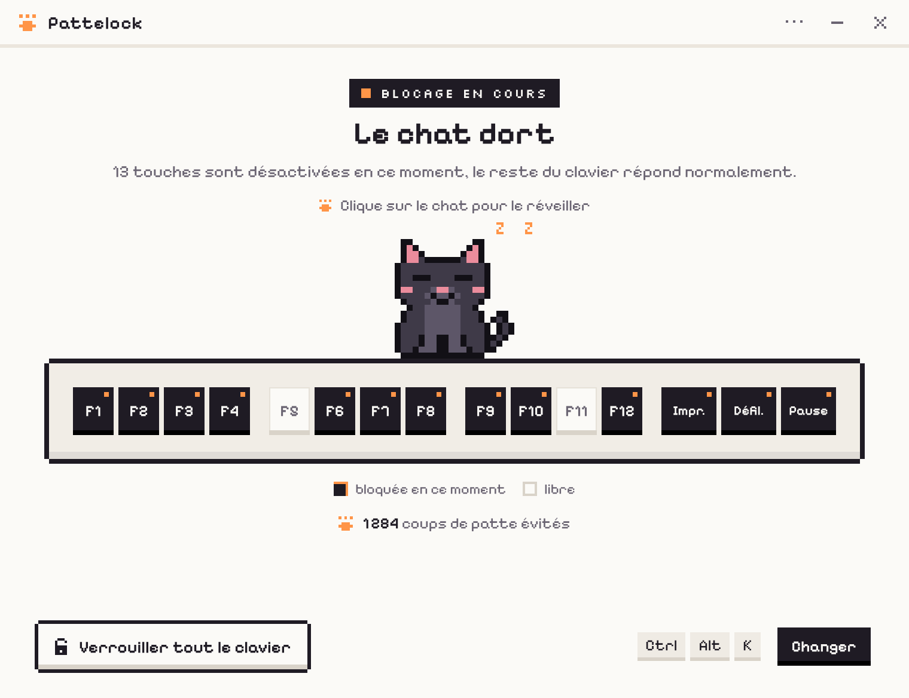

# Pattelock

Ton chat s'allonge sur le clavier ? Pattelock désactive temporairement certaines touches pour que rien ne se déclenche : F1 à F12, Impr. écran, Arrêt défil. et Pause, ou même tout le clavier. La souris, elle, fonctionne toujours.



Petite app desktop pour Windows, macOS et Linux, construite avec [Tauri 2](https://tauri.app).

## Fonctionnalités

- **Blocage global** des touches F1 à F12, Impr. écran, Arrêt défil. et Pause, même quand Pattelock n'a pas le focus. Chaque touche se bloque ou se libère d'un clic sur la bande clavier.
- **Le chat comme interrupteur** : il dort quand la protection est active, il se réveille quand elle est en pause. Clique dessus pour basculer.
- **Verrouiller tout le clavier** : bloque toutes les touches, sauf la combinaison de déverrouillage. On en sort par le bouton « Déverrouiller le clavier », en cliquant sur le chat, avec le raccourci ou depuis le tray.
- **Raccourci global** pour basculer, `Ctrl + Alt + K` par défaut (`Cmd + Option + K` sur Mac), modifiable avec le bouton « Changer ».
- **Compteur** de coups de patte évités depuis l'installation.
- **Chat animé** en pixel art : il respire et ronfle quand il dort, suit le curseur des yeux quand il est réveillé. Cinq pelages, quatre couleurs d'accent, thèmes clair, sombre ou système.
- **Tray** : Pattelock reste dans la barre des tâches (ou la barre de menus) quand on ferme la fenêtre, et peut se lancer au démarrage.

Aucun appel réseau. Les réglages et le compteur sont enregistrés localement.

## Installation

Les installateurs sont publiés sur la page [Releases](https://github.com/HugoSohm/pattelock/releases).

### Windows

Lance `Pattelock_x.y.z_x64-setup.exe` (ou `arm64`). Aucune autorisation particulière n'est nécessaire.

### macOS

L'app n'est pas signée avec un certificat Apple Developer, d'où deux étapes en plus :

1. Ouvre `Pattelock_x.y.z_aarch64.dmg` (Apple Silicon) ou `_x64.dmg` (Intel) et glisse **Pattelock.app** dans **Applications**.
2. Dans un terminal :
   ```bash
   sudo xattr -c /Applications/Pattelock.app
   ```
3. Au premier lancement, autorise Pattelock dans **Réglages Système > Confidentialité et sécurité > Accessibilité**. C'est nécessaire pour bloquer des touches. Pattelock affiche un écran avec un bouton qui ouvre directement ce réglage, et démarre le blocage dès que l'autorisation est donnée.

> Comme l'app est signée « ad hoc », macOS peut redemander l'autorisation Accessibilité après chaque mise à jour. Retire alors Pattelock de la liste et ajoute-le de nouveau.

### Linux

Trois formats : `.AppImage`, `.deb` (Debian, Ubuntu…) et `.rpm` (Fedora…).

- **Session X11** : rien à faire, le blocage fonctionne sans droits particuliers.
- **Session Wayland** : il n'existe pas d'API pour avaler des touches. Pattelock lit donc les claviers dans `/dev/input` et réémet les touches non bloquées par un clavier virtuel `/dev/uinput`. Il faut appartenir au groupe `input` :
  ```bash
  sudo usermod -aG input $USER
  ```
  puis fermer la session et se reconnecter. Les paquets `.deb` et `.rpm` installent la règle udev qui donne l'accès à `/dev/uinput` (`/usr/lib/udev/rules.d/70-pattelock.rules`). Avec l'AppImage, Pattelock affiche la commande complète à lancer, règle comprise. La règle est aussi disponible dans [`packaging/linux/`](packaging/linux/).

> Être dans le groupe `input` permet à tes programmes de lire tout le clavier. C'est le prix à payer pour bloquer des touches sous Wayland.

## Bon à savoir

- **On ne peut pas se retrouver enfermé dehors** : en mode clavier entier, la combinaison de déverrouillage est reconnue par le hook lui-même. Le mode clavier entier n'est jamais restauré au redémarrage. Si Pattelock se ferme ou plante, le blocage disparaît avec lui.
- `Ctrl + Alt + Suppr` (Windows) et les raccourcis système non interceptables restent actifs.
- **Windows** : quand une fenêtre lancée en administrateur a le focus, Windows ne transmet pas les touches au hook de Pattelock.
- **macOS** : la rangée du haut envoie souvent des fonctions média (luminosité, son). L'option « Bloquer aussi les fonctions média de la rangée du haut » (active par défaut) les bloque avec la touche F correspondante. Impr. écran, Arrêt défil. et Pause n'existent pas sur un clavier Mac : elles deviennent F13, F14 et F15. Pendant la saisie d'un mot de passe (saisie sécurisée), macOS ne transmet pas les touches. Certaines touches (Globe / fn) sont gérées plus bas que Pattelock.
- **Linux X11** : une touche déjà réservée par le bureau (souvent Impr. écran pour les captures) ne peut pas être bloquée ; Pattelock l'indique.

## Développement

### Prérequis

- [Node.js](https://nodejs.org) 24 ou plus
- [Rust](https://rustup.rs) stable
- Les [prérequis Tauri 2](https://tauri.app/start/prerequisites/) de ton OS (Build Tools C++ et WebView2 sous Windows, Xcode Command Line Tools sous macOS, `libwebkit2gtk-4.1-dev`, `libayatana-appindicator3-dev`… sous Linux)

### Commandes

```bash
npm ci
```

```bash
npm run dev
```

```bash
npm run build
```

| Commande | Rôle |
|---|---|
| `npm run dev` | Lance l'app en développement |
| `npm run build` | Construit l'app et ses installateurs |
| `npm run frontend:dev` | Interface seule dans un navigateur, avec un faux backend (`?etat=pause`, `?etat=tout`, `?vue=reglages`, `?theme=dark`, `?plateforme=macos`…) |
| `npm run typecheck` / `npm run lint` | TypeScript et Biome |
| `npm run test:rs` / `npm run lint:rs` / `npm run format:rs` | Tests, clippy et rustfmt |
| `npm run icons` | Regénère les icônes de l'app et du tray à partir du sprite du chat |
| `npm run demo:build` | Regénère [`docs/maquette/anim-demo.html`](docs/maquette/anim-demo.html), la démo de toutes les animations du chat |

Le DMG macOS est construit par [`scripts/macos/build.sh`](scripts/macos/build.sh) après `npm run tauri build -- --bundles app`.

### Organisation

```
src/                    interface (Vite + TypeScript, sans framework)
  cat/                  sprite, pelages, rendu canvas, animations
  ui/                   écrans et composants
src-tauri/src/
  core.rs               état central, persistance, événements vers l'interface
  keyguard/             blocage des touches : un module par OS
  window.rs             fenêtre au tiers de l'écran, centrée
  tray.rs, hotkey.rs, autostart.rs, cursor.rs
docs/maquette/          maquette de référence et démo des animations
packaging/linux/        règle udev et module uinput
scripts/                icônes, fond du DMG, script DMG
```

## Licence

[AGPL-3.0-or-later](LICENSE). Polices Pixelify Sans et Silkscreen sous [SIL Open Font License](src/assets/fonts/OFL.txt).
