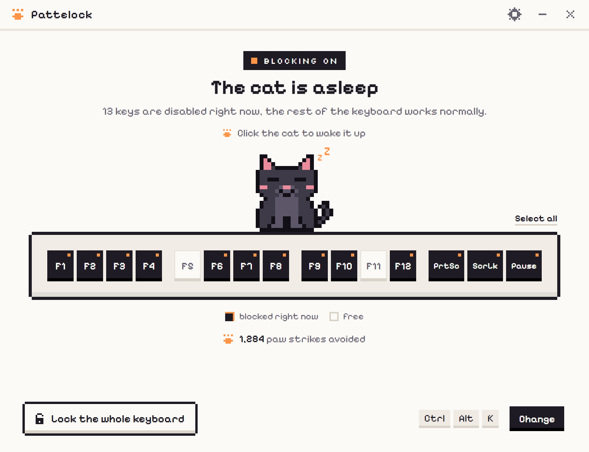
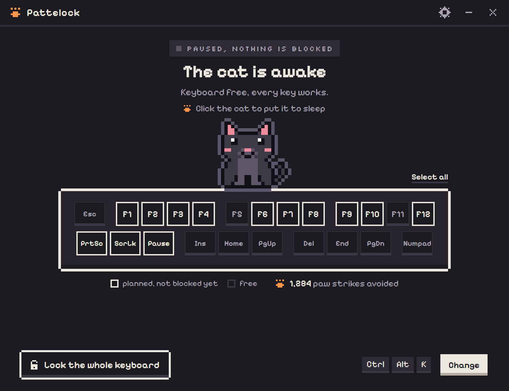
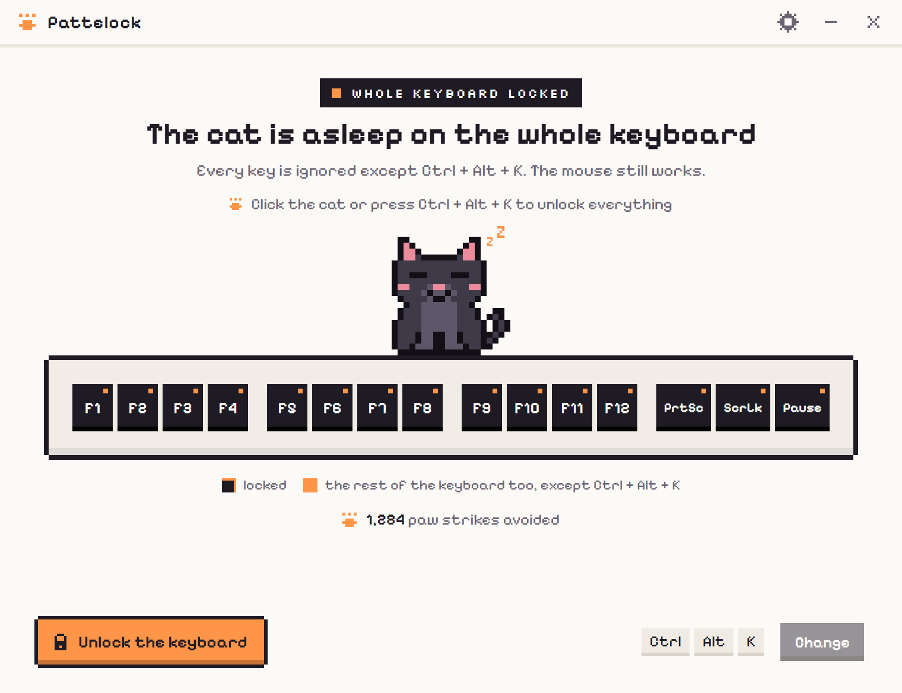
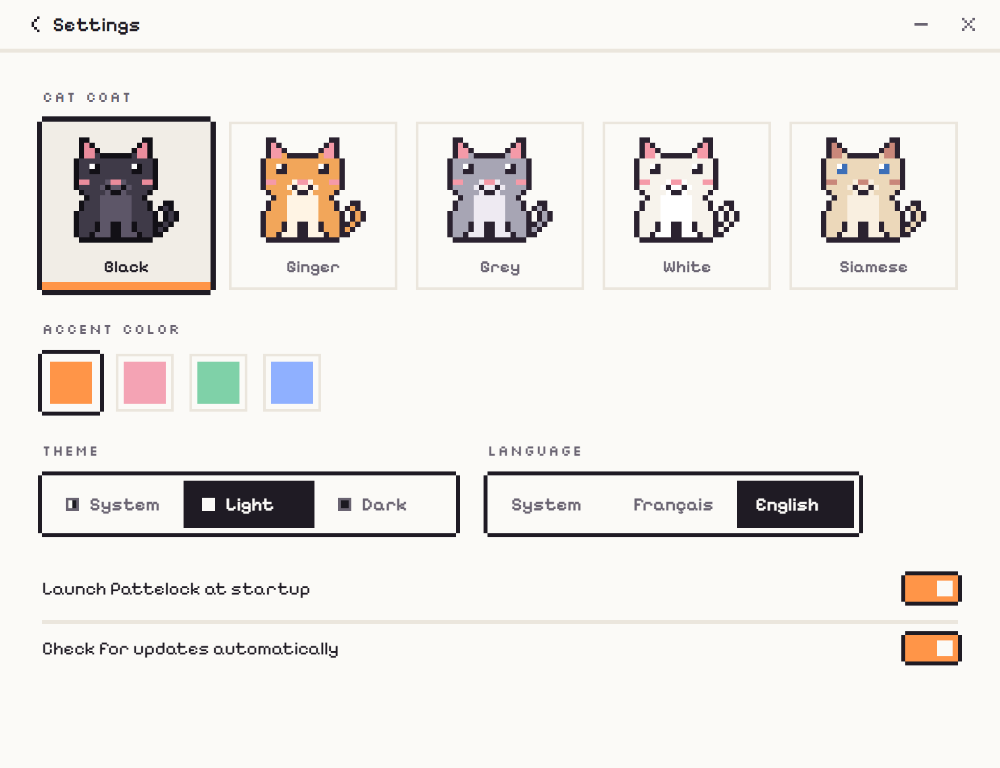

<div align="center">
  
  <h1>Pattelock</h1>
  <p>Let your cat nap on the keyboard. Pattelock disables the keys it would press.</p>

  [](https://github.com/HugoSohm/pattelock/releases/latest)
  [](https://tauri.app/)
  [](https://www.typescriptlang.org/)
  [](https://www.rust-lang.org/)
  [](https://github.com/HugoSohm/pattelock/releases/latest)
  [](LICENSE)
</div>

---

**Pattelock** is a small desktop app for **cat owners who work at a computer**. When your cat lies down on the keyboard, the keys you pick among Esc, F1 to F12, Print Screen, Scroll Lock, Pause and the Insert / Home / Page Up / Delete / End / Page Down block stop doing anything: no help page, no reload, no full screen, no screenshot. Need more? Lock the whole keyboard in one click. Your mouse keeps working.

<div align="center">
  
  
</div>

### ✨ Features

- 🐾 **System-wide blocking**: Esc, F1 to F12, Print Screen, Scroll Lock, Pause and the navigation block (Insert, Home, Page Up, Delete, End, Page Down) are swallowed even when Pattelock is in the background. Click a key on the strip to block or free it. The top row is blocked by default.
- 😺 **The cat is the switch**: it sleeps while protection is on and wakes up when it's paused. Click it to toggle.
- 🔒 **Lock the whole keyboard**: every key is ignored except the unlock shortcut. Get out with the "Unlock keyboard" button, by clicking the cat, with the shortcut or from the tray.
- ⌨️ **Global shortcut**: `Ctrl + Alt + K` (`Cmd + Option + K` on macOS) toggles protection from anywhere. Change it with one click.
- 📊 **Paw counter**: counts every keystroke your cat didn't get to send, since installation.
- 🎨 **Animated pixel cat**: it breathes and snores while asleep, and follows your cursor with its eyes when awake. Five coats, four accent colors, light, dark or system theme.
- 🌍 **English & French**: follows your system language, or pick one in the settings.
- 🗂️ **Lives in the tray**: closing the window keeps Pattelock running in the taskbar or menu bar, and it can start with your session.
- 🔄 **Automatic updates**: Pattelock checks GitHub for a new version and installs it in one click. You can turn the check off in the settings.
- 🔒 **Private by design**: no telemetry. The only network call is the optional update check. Settings and the counter stay on your machine.

### 📸 Screenshots

<div align="center">
  
  
</div>

---

### 📦 Installation

Download the installer for your system from the [latest release](https://github.com/HugoSohm/pattelock/releases/latest).

| System | File |
| --- | --- |
| Windows | `Pattelock_x.y.z_x64-setup.exe` or `_arm64-setup.exe` |
| macOS | `Pattelock_x.y.z_aarch64.dmg` (Apple Silicon) or `_x64.dmg` (Intel) |
| Linux | `.AppImage`, `.deb` (Debian, Ubuntu...) or `.rpm` (Fedora...) |

### 🍎 macOS Setup

Pattelock is not signed with an Apple Developer certificate, so macOS needs two extra steps:

1. Move `Pattelock.app` to your `/Applications` folder.
2. Open a terminal and run:
   ```bash
   sudo xattr -c /Applications/Pattelock.app
   ```
3. On first launch, allow Pattelock in **System Settings > Privacy & Security > Accessibility**. This is required to block keys. Pattelock shows a screen with a button that opens the right settings pane, and starts blocking as soon as permission is granted.

> [!NOTE]
> Because the app is ad hoc signed, macOS may ask for the Accessibility permission again after each update. If blocking stops working, remove Pattelock from the list and add it back.

### 🐧 Linux Setup

- **X11 session**: nothing to do, blocking works without special permissions.
- **Wayland session**: Wayland has no API to swallow keys, so Pattelock reads keyboards from `/dev/input` and replays the keys it doesn't block through a virtual keyboard (`/dev/uinput`). Add yourself to the `input` group, then log out and back in:
  ```bash
  sudo usermod -aG input $USER
  ```
  The `.deb` and `.rpm` packages install the udev rule that grants access to `/dev/uinput`. With the AppImage, Pattelock shows the full command to run, rule included. The rule is also available in [`packaging/linux/`](packaging/linux/).

> [!WARNING]
> Members of the `input` group can read every keystroke. This is the price of blocking keys on Wayland.

---

### 🛡️ Safety Nets

You can never get locked out:
- In whole-keyboard mode, the unlock shortcut is recognized by the keyboard hook itself.
- Whole-keyboard mode is never restored on restart.
- If Pattelock quits or crashes, blocking goes away with it.
- `Ctrl + Alt + Del` on Windows and other system shortcuts that apps cannot intercept keep working.

### ⚠️ Known Limitations

- **Windows**: when a window running as administrator has focus, Windows does not send keys to Pattelock's hook.
- **macOS**: Macs have no Print Screen, Scroll Lock or Pause keys, so they become F13, F14 and F15, and Insert is the Help key. The top row often sends media functions (brightness, volume): the "also block media functions" option (on by default) blocks them along with the matching F key. During secure input (password fields), macOS hides keystrokes from all apps. Some keys (Globe / fn) are handled below Pattelock.
- **Linux X11**: a key already reserved by your desktop (often Print Screen for screenshots) cannot be blocked. Pattelock tells you which ones.

---

### 🚀 Quick Start Guide (Development)

#### 1. Prerequisites
- [Node.js](https://nodejs.org/) 24 or later
- [Rust](https://www.rust-lang.org/tools/install) (via rustup)
- The [Tauri 2 prerequisites](https://tauri.app/start/prerequisites/) for your OS (C++ Build Tools and WebView2 on Windows, Xcode Command Line Tools on macOS, `libwebkit2gtk-4.1-dev` and `libayatana-appindicator3-dev` on Linux)

#### 2. Installation
Clone the repo and install dependencies:
```bash
npm ci
```

#### 3. Run in Development
```bash
npm run dev
```

> [!NOTE]
> Key blocking is live in development too. If you lock the whole keyboard, `Ctrl + Alt + K` or a click on the cat gets you out, and stopping the dev server removes the hook.

To work on the interface only, without Rust, run `npm run frontend:dev` and open http://localhost:1420. A fake backend replaces the app core, and URL parameters force a state: `?etat=pause`, `?etat=tout`, `?vue=reglages`, `?theme=dark`, `?langue=en`, `?plateforme=macos`. All cat animations are shown at http://localhost:1420/anim-demo.html.

---

### 🏗️ Build (Production)
To generate the installers for your platform:
```bash
npm run build
```
Installers will be located in: `src-tauri/target/release/bundle/`

The macOS DMG is assembled by [`scripts/macos/build.sh`](scripts/macos/build.sh) after building the `.app` bundle.

### 🛠️ Tech Stack
- **Frontend**: TypeScript (no framework), Vite, canvas pixel art.
- **Backend**: Rust (Tauri 2.0).
- **Keyboard hooks**: `SetWindowsHookExW` on Windows, `CGEventTap` on macOS, `XGrabKey` / `XGrabKeyboard` on X11, `evdev` + `uinput` on Wayland.

---

### 🤝 Contributing

Contributions are welcome! Read the [Contributing Guide](CONTRIBUTING.md) to get started.

---

### 🛡️ Security

If you discover a security vulnerability within Pattelock, please report it privately via the [Security Policy](SECURITY.md).

---

### 📜 License

This project is licensed under the [GNU AGPLv3 License](LICENSE). The Pixelify Sans and Silkscreen fonts are licensed under the [SIL Open Font License](src/assets/fonts/OFL.txt).
